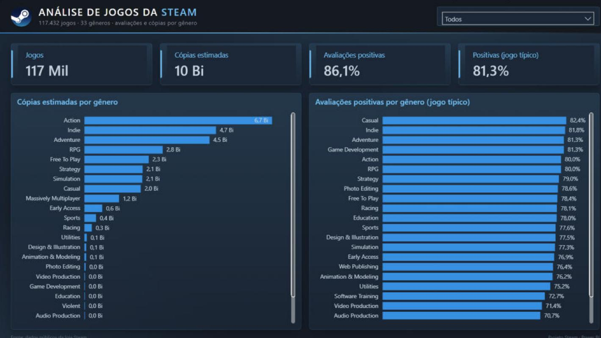
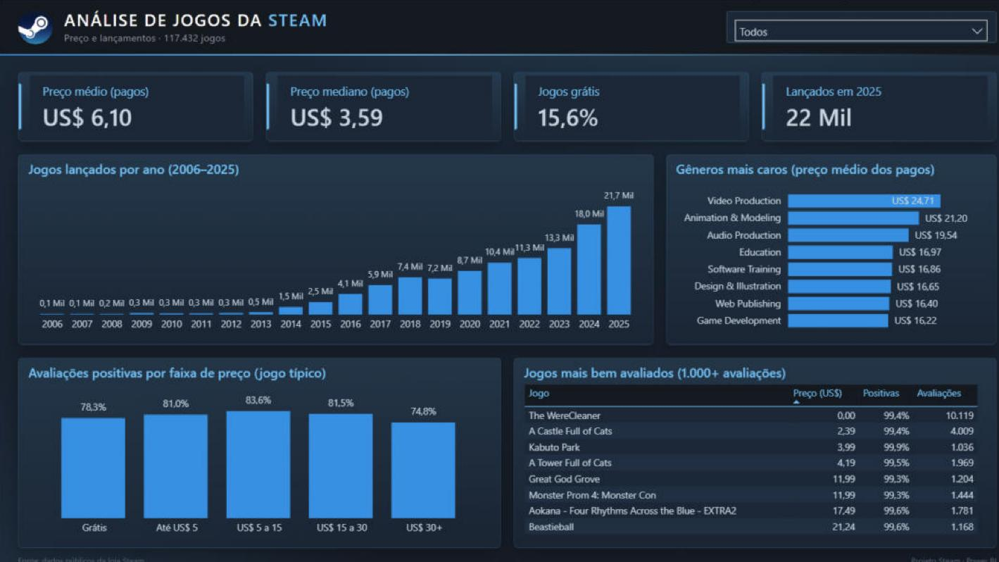
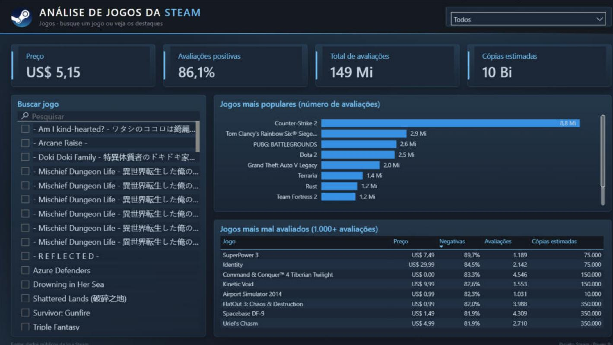

# Análise de Jogos da Steam | Pipeline de dados + Dashboard Power BI

Projeto de análise do catálogo da **loja Steam**, cobrindo o caminho completo de um analista de dados: **base bruta do Kaggle → limpeza em Python → modelagem e dashboard no Power BI**, com identidade visual inspirada na própria loja.



---

## 🎯 Objetivo

Entender **quais gêneros dominam a Steam em volume e em avaliação**, como **preço e ano de lançamento** se relacionam com a recepção dos jogadores, e permitir **buscar um jogo específico** para ver seus números.

## 🛠️ Tecnologias

| Etapa | Ferramenta |
|---|---|
| Fonte dos dados | [Steam Games Dataset](https://www.kaggle.com/datasets/fronkongames/steam-games-dataset) (Kaggle) |
| Limpeza e exportação | Python 3.13 · pandas · Jupyter Notebook |
| Modelagem e visualização | Power BI Desktop (Power Query, DAX, formato PBIP) |
| Identidade visual | Tema JSON + fundos de página em HTML/CSS renderizados em PNG |

---

## 📋 Passo a passo

### 1. Fonte (Kaggle)
O `games.csv` (~400 MB, **125.855 jogos**) traz identificação, gêneros, preço, avaliações positivas/negativas, faixa de donos estimados e data de lançamento de cada jogo publicado na loja.

### 2. Limpeza e exportação (Python — `analise.ipynb`)

| # | Etapa | Por quê |
|---|---|---|
| 1 | Correção do cabeçalho | O CSV original junta `Discount` e `DLC count` em uma coluna só (`DiscountDLC count`), o que desalinhava todas as colunas seguintes |
| 2 | Seleção de 9 colunas | Só o que a análise usa: `AppID`, `Name`, `Genres`, `Categories`, `Price`, `Positive`, `Negative`, `Estimated owners`, `Release date` |
| 3 | Conversão de `Release date` | Datas em formatos mistos viraram `datetime` (0 falhas de conversão) |
| 4 | Faixa de donos → números | `"0 - 20000"` virou `Owners min`, `Owners max` e `Owners` (ponto médio da faixa) |
| 5 | Remoção de jogos sem gênero | **8.423 jogos** sem `Genres` (quase todos também sem donos) foram descartados |
| 6 | Flag `Tem donos` | Marca os 16.281 jogos com faixa `0 - 0` sem removê-los |
| 7 | Gêneros explodidos | `"Casual,Indie,Simulation"` vira uma linha por gênero: **338.583 pares** jogo/gênero, 33 gêneros |
| 8 | Exportação em duas tabelas | `jogos.csv` (um jogo por linha) e `jogos_generos.csv` (ponte jogo/gênero), separador `;` e decimal `,` para o Power BI em português |

Resultado: **125.855 → 117.432 jogos**, 0 `AppID` duplicados.

> A exportação em duas tabelas evita contar o mesmo jogo várias vezes: um jogo com 3 gêneros aparece uma única vez em `jogos.csv`, então as somas de avaliações e cópias saem corretas.

### 3. Modelagem (Power BI)

**Power Query**
- Leitura dos dois CSVs com `Csv.Document` (UTF-8, `;`) e tipos convertidos com cultura `pt-BR`.

**Modelo**
- Tabela `Jogos` (fato, um jogo por linha) + tabela ponte `Jogos Generos`, relacionadas por `AppID` (1:N, filtro **nas duas direções**, para que escolher um gênero filtre os jogos).
- Colunas calculadas: `Ano Lançamento` e `Faixa de Preço` (Grátis, Até US$ 5, US$ 5 a 15, US$ 15 a 30, US$ 30+), ordenada por uma coluna oculta.

**Medidas DAX principais**

```dax
% Positivas = DIVIDE([Avaliações Positivas], [Avaliações Positivas] + [Avaliações Negativas])

% Positivas (Mediana por Jogo) =
    MEDIANX(
        FILTER(Jogos, Jogos[Positive] + Jogos[Negative] >= 10),
        DIVIDE(Jogos[Positive], Jogos[Positive] + Jogos[Negative])
    )

Cópias Estimadas      = SUM(Jogos[Owners])
Preço Médio (Pagos)   = CALCULATE(AVERAGE(Jogos[Price]), Jogos[Price] > 0)
Preço Mediano (Pagos) = CALCULATE(MEDIAN(Jogos[Price]), Jogos[Price] > 0)
Lançamentos em 2025   = CALCULATE([Qtd Jogos], Jogos[Ano Lançamento] = 2025)
```

> Duas visões de avaliação lado a lado: a **% Positivas** soma as avaliações de todos os jogos (os grandes sucessos pesam mais), enquanto a **mediana por jogo** mostra o jogo "típico" de cada gênero. Os rankings usam medidas auxiliares ocultas (`Preço Médio (Gêneros 100+)`, `% Positivas (1.000+ Avaliações)`, `% Negativas (1.000+ Avaliações)`) para que gêneros ou jogos com pouca amostra não entrem no topo.

### 4. Dashboard

Três páginas, com **filtro de gênero sincronizado** no cabeçalho de todas:

**Visão Geral**
- **KPIs:** jogos, cópias estimadas, % de avaliações positivas e positivas no jogo típico.
- **Cópias estimadas por gênero** e **avaliações positivas por gênero** (gêneros com 100+ jogos).

**Preço e Lançamentos**
- **KPIs:** preço médio e mediano dos jogos pagos, % de jogos grátis e lançamentos em 2025.
- **Jogos lançados por ano** (2006–2025), **gêneros mais caros**, **avaliações por faixa de preço** e **jogos mais bem avaliados** (1.000+ avaliações).



**Jogos**
- **Busca de jogo:** ao selecionar um jogo, os KPIs mostram preço, avaliações e cópias dele.
- **Jogos mais populares** (número de avaliações) e **jogos mais mal avaliados** (1.000+ avaliações).



---

## 🔍 Principais achados

- **Action** lidera em cópias estimadas (**6,7 bi**), seguido de Indie (4,7 bi) e Adventure (4,5 bi).
- No jogo típico, **Casual (82,4%)** e **Indie (81,8%)** são os gêneros mais bem avaliados; **Massively Multiplayer** e os gêneros de conteúdo adulto/violento ficam abaixo de 67%.
- Os lançamentos explodiram: de **69 jogos em 2006** para **21.664 em 2025**.
- Jogos de **US$ 5 a 15** são os mais bem avaliados (**83,6%** no jogo típico); os de **US$ 30+** são os piores (**74,8%**).
- A maioria dos jogos pagos é barata: **mediana de US$ 3,59** contra média de US$ 6,10. Os gêneros mais caros são de software (Video Production, US$ 24,71), não de jogos.
- **Counter-Strike 2** é de longe o mais popular, com **8,8 milhões de avaliações** — 3x o segundo colocado.

## ⚠️ Limitações

- **Cópias estimadas ≠ pessoas:** a base só informa uma **faixa** de donos por jogo (ex.: `0 - 20000`). A medida soma o ponto médio dessas faixas, então conta **cópias**, e quem tem 50 jogos entra 50 vezes. Por isso o total passa de 10 bilhões.
- **2026 fora do gráfico por ano:** a base tem só os primeiros meses de 2026 (3.306 jogos), e o ano incompleto pareceria uma queda.
- **Arredondamento dos cartões:** os KPIs usam unidade automática — "Lançados em 2025" mostra **22 Mil** para 21.664, e "117 Mil" jogos são 117.432.
- **Filtros de amostra mínima:** a mediana por jogo só considera jogos com **10+ avaliações**; os gráficos por gênero ignoram gêneros com **menos de 100 jogos**; os rankings de jogos exigem **1.000+ avaliações** — sem isso, jogos com 2 ou 3 avaliações apareceriam com 100%.
- **Preços em US$** vêm da própria base; o preço médio e mediano consideram só os jogos pagos.
- **Gêneros não exclusivos:** um jogo com vários gêneros conta em todos eles nos gráficos por gênero.

## 🚧 Próximos passos

- Automação da atualização: script que baixa a nova versão do dataset pela API do Kaggle (só quando mudar), aplica a mesma limpeza do notebook e regera os CSVs por tarefa agendada no Windows.

---

## 📁 Estrutura do repositório

```
├── README.md
├── analise.ipynb               # limpeza e exportação (Python)
├── main.py                     # rascunho inicial da leitura do CSV
├── games.csv / games.json      # base bruta do Kaggle (não versionada, ~400 MB / ~970 MB)
├── jogos.csv                   # um jogo por linha (camada ready)
├── jogos_generos.csv           # ponte jogo/gênero (camada ready)
├── fundo/                      # fundos das páginas (HTML → PNG), logo e tema
├── images/                     # prints do dashboard
├── Dashboard.pbip              # abre o projeto no Power BI Desktop
├── Dashboard.Report/           # definição do relatório (PBIR)
└── Dashboard.SemanticModel/    # modelo semântico (TMDL)
```

## ▶️ Como reproduzir

1. Baixe o `games.csv` do [Steam Games Dataset](https://www.kaggle.com/datasets/fronkongames/steam-games-dataset) e coloque na pasta do projeto.
2. Instale as dependências: `pip install pandas jupyter`.
3. Abra `analise.ipynb` e rode todas as células (**Run All**) — ao final são gerados `jogos.csv` e `jogos_generos.csv`.
4. Abra `Dashboard.pbip` no Power BI Desktop, em **Transformar dados** ajuste o caminho dos dois CSVs para a sua pasta e clique em **Atualizar**.

---

**Autor:** Victor Bandeira · [LinkedIn](https://www.linkedin.com/in/victor-bandeira-448b1a206/) · [GitHub](https://github.com/Bandeira1)
